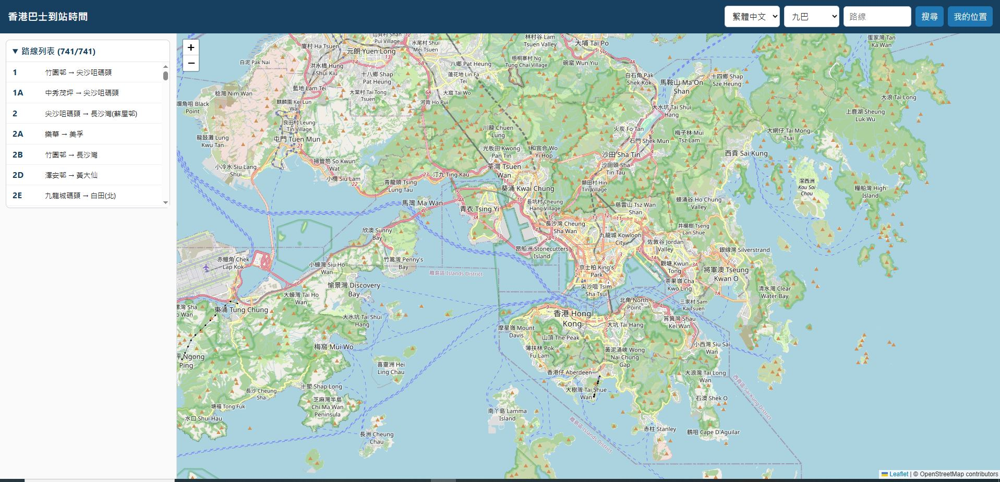
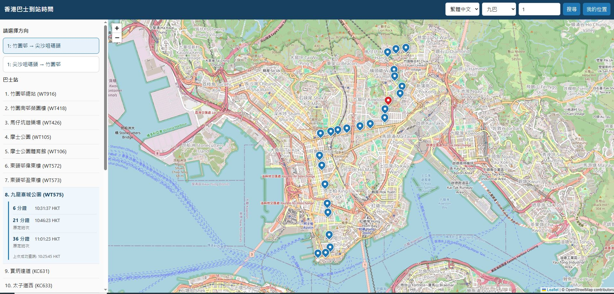
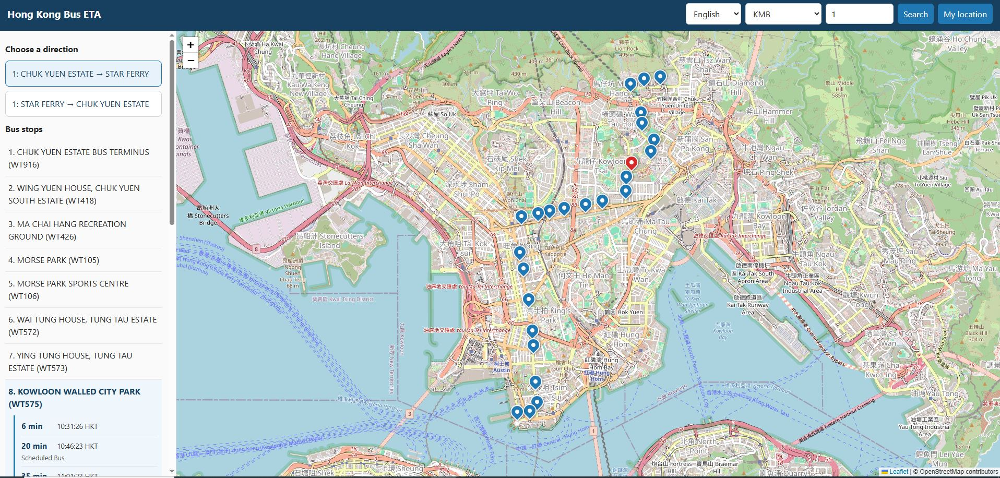
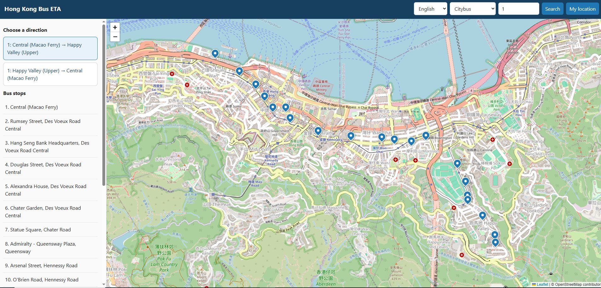
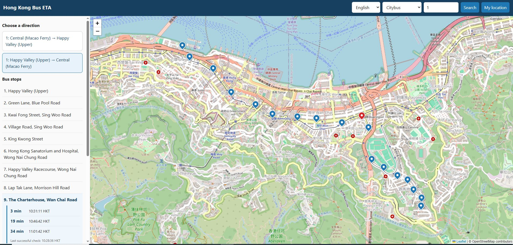
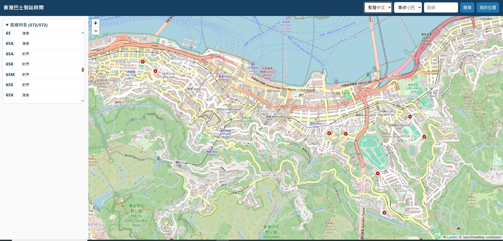
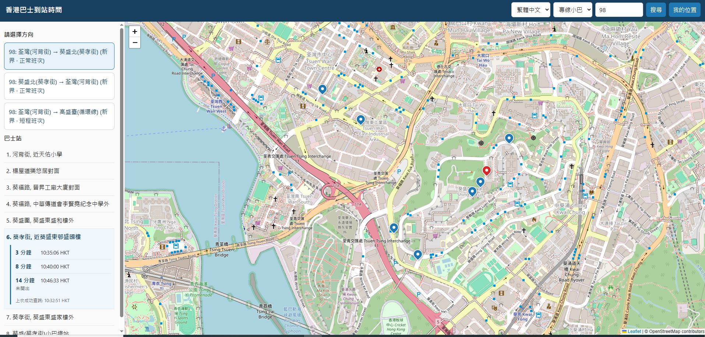
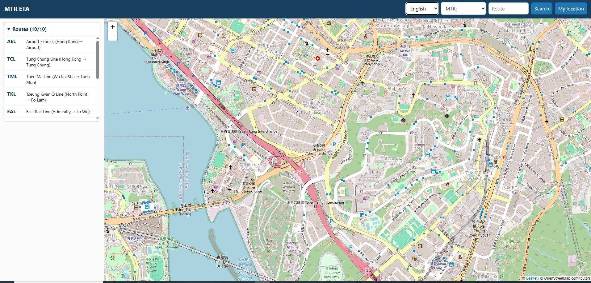
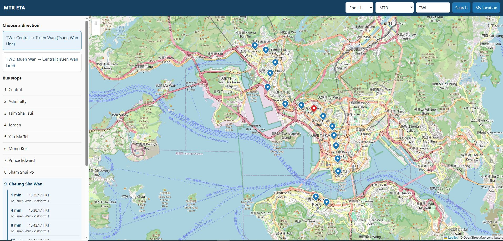

# Hong Kong Transport ETA (Estimated Time of Arrival)

A lightweight web application that aggregates real-time estimated arrival times (ETA) across major Hong Kong public transit operators, including **MTR**, **KMB**, **LWB**, **Citybus**, and **Green Minibus (GMB)**.

---

## Features
* Multi-Operator Support: Check live arrivals across MTR, KMB, LWB, Citybus, and Green Minibus.
* Interactive Map Integration: View station layouts and stop markers using Leaflet / OpenStreetMap.
* Multilingual Interface: Full support for English, Traditional Chinese (繁體中文), and Simplified Chinese (简体中文).
* Self-Contained Executable: Bundled using PyInstaller for seamless execution on Windows.

## Getting Started
* Prerequisites
  Windows 10 or 11 (64-bit)
  A modern web browser (Chrome, Firefox, Edge, Safari)

* Installation & Execution
Clone or Download this repository to your local machine:

* Bash
git clone https://github.com/hchu001/hk-transport-eta.git
cd hk-transport-eta
Ensure that both the executable (hk-transport-eta-app.exe) and your configuration file (.env) reside in the same root folder.
Configure Environment Variables: Open the .env file and verify your port configurations or map provider keys if necessary.

* Run the Application:
Double-click hk-transport-eta-app.exe, or run it via your command prompt:

* Bash
hk-transport-eta-app.exe
Open your web browser and navigate to:[http://127.0.0.1:5003](http://127.0.0.1:5003) (or the custom port defined in your .env file).

Configuration (.env)
The application reads configuration parameters from the .env file placed next to the executable. Example parameters include:

Code snippet
FLASK_HOST=127.0.0.1
FLASK_PORT=5003
MAP_PROVIDER=leaflet
ETA_REFRESH_SECONDS=30

### Screenshots

### Download
See Releases page.

## License
This project is open-source and available under the MIT License.